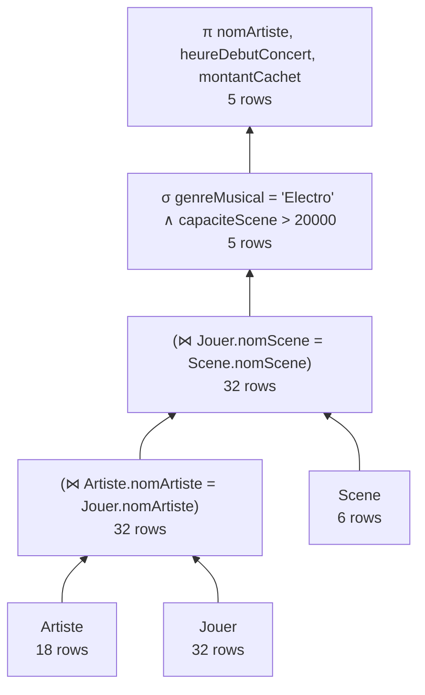
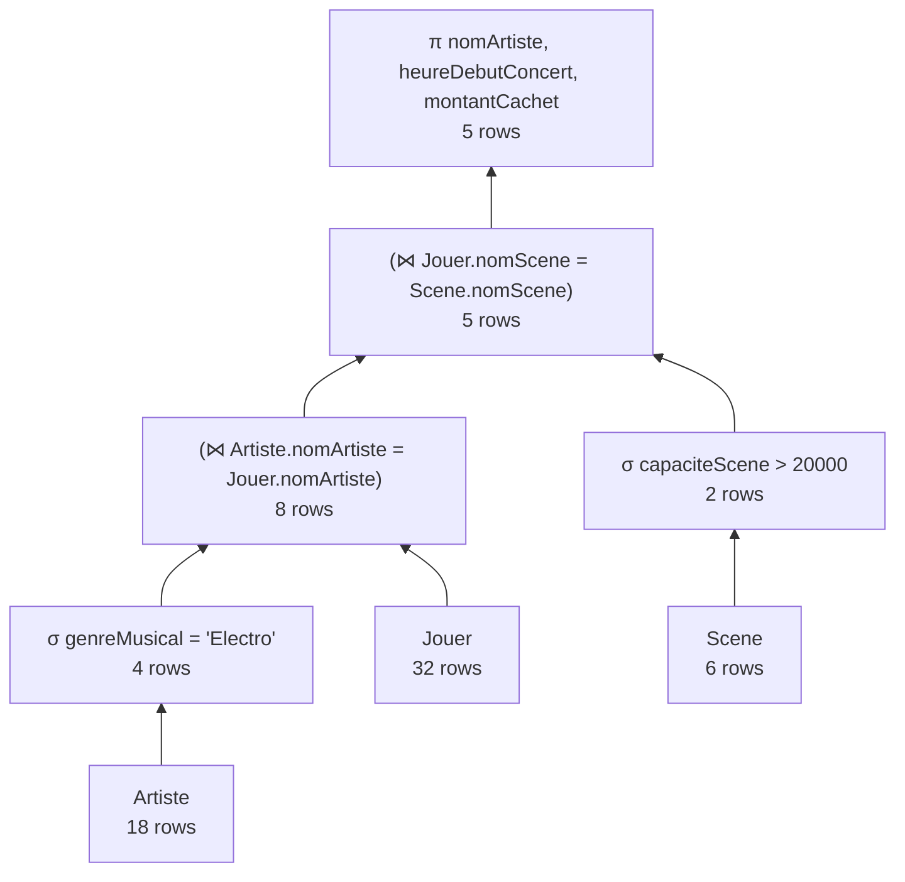
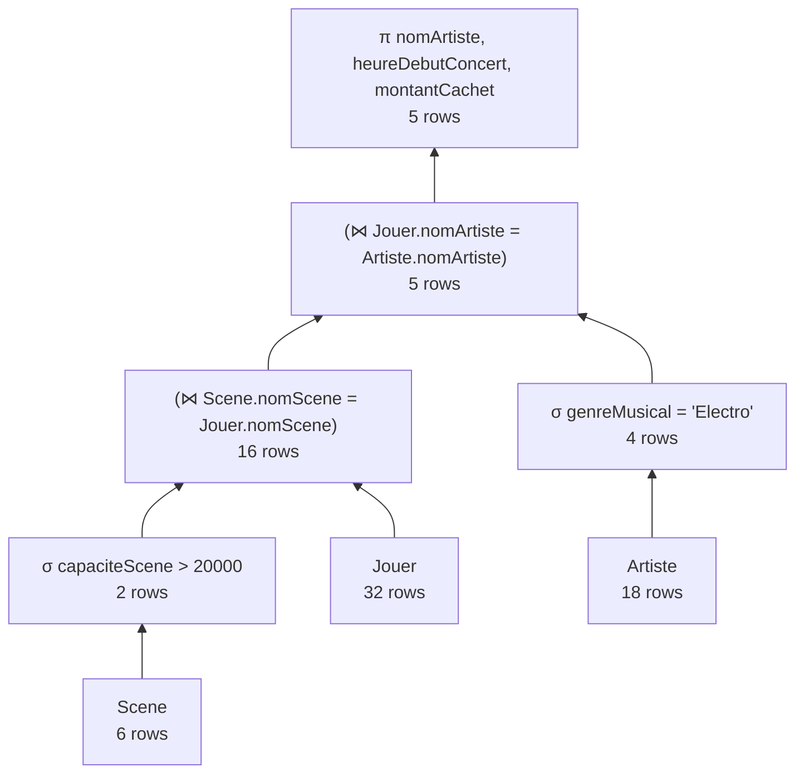

# festivalDB — Base de données d'un festival de musique (MySQL)

Projet de bases de données réalisé à l'Efrei en binôme par **Youssef Mayassi** et **Hugo Jumel** (2026).
Conception complète, de l'analyse des besoins jusqu'à l'optimisation des requêtes, pour la billetterie et la programmation d'un festival fictif (*Echoes du Parc*) inspiré de Rock en Seine et du Hellfest.

## En bref

- **Méthode MERISE** : règles de gestion, dictionnaire de 34 données, MCD (Looping), MLD de 12 tables.
- **SQL (MySQL / MariaDB)** : création, contraintes d'intégrité (`CHECK`, clés étrangères, `ON DELETE CASCADE / SET NULL`), jeu de données cohérent (~210 lignes).
- **24 requêtes métier** : sélections, agrégations (`GROUP BY` / `HAVING`), jointures internes et externes, sous-requêtes (`IN`, `NOT IN`, `EXISTS`, `NOT EXISTS`, `ANY`, `ALL`).
- **Optimisation** : comparaison de 3 plans d'exécution en algèbre relationnelle, de 805 à 157 opérations (÷5) en poussant les sélections avant les jointures.
- **IA générative** : les prompts utilisés pour l'analyse des besoins et la génération des données sont fournis ([prompts/](prompts/)).

## Lancer le projet

```bash
mysql -u root -p < sql/1_creation.sql
mysql -u root -p < sql/2_contraintes.sql
mysql -u root -p < sql/3_insertion.sql
mysql -u root -p < sql/4_interrogation.sql
```

Les quatre scripts s'exécutent sans erreur sur MariaDB 10.11 / MySQL 8.

## Contenu du dépôt

| Fichier | Rôle |
|---|---|
| `sql/1_creation.sql` | Création de la base et des 12 tables |
| `sql/2_contraintes.sql` | Contraintes de validation (`CHECK`) |
| `sql/3_insertion.sql` | Jeu de données (3 éditions, 18 artistes, 32 concerts, 28 commandes…) |
| `sql/4_interrogation.sql` | Les 24 requêtes du scénario d'utilisation |
| `docs/MCD.jpg`, `docs/MCD.loo` | Modèle conceptuel (image et fichier Looping) |
| `docs/Mini_Projet_1_Base_Prompt.pdf` | Prompt d'analyse des besoins |
| `prompts/prompt_insertion.txt` | Prompt de génération du jeu de données |

---

# Mini-projet de bases de données — Festival de musique

## Partie 1 — Analyse des besoins et MCD

**Domaine choisi :** organisation d'un festival de musique par une association fictive en France.

### 1. Prompt final utilisé

```text
Tu travailles dans le domaine de l’organisation de festivals de musique. Ton organisation a comme activité d’organiser un festival sur plusieurs jours et plusieurs scènes. C’est une organisation qui s’inspire de festivals existants comme Rock en Seine et le Hellfest. Les données concernent les éditions, les scènes, les artistes, les concerts, les créneaux et les billets. Inspire-toi des informations publiques disponibles sur les sites officiels suivants : Rock en Seine et Hellfest.

Ton association veut appliquer MERISE pour concevoir un système d'information. Tu es chargé de la partie analyse, c’est-à-dire de collecter les besoins auprès de l’entreprise. Elle a fait appel à un étudiant en ingénierie informatique pour réaliser ce projet, tu dois lui fournir les informations nécessaires pour qu’il applique ensuite lui-même les étapes suivantes de conception et développement de la base de données.

D’abord, établis les règles de gestion des données de ton association, sous la forme d'une liste à puces. Elle doit correspondre aux informations que fournit quelqu’un qui connaît le fonctionnement de l’entreprise, mais pas comment se construit un système d’information.

Ensuite, à partir de ces règles, fournis un dictionnaire de données brutes avec les colonnes suivantes, regroupées dans un tableau : signification de la donnée, type, taille en nombre de caractères ou de chiffres. Il doit y avoir entre 25 et 35 données. Il sert à fournir des informations supplémentaires sur chaque donnée (taille et type) mais sans a priori sur comment les données vont être modélisées ensuite.

Fournis donc les règles de gestion et le dictionnaire de données.
```

### 2. Règles métier obtenues

1. Une ou plusieurs associations (chacune identifiée par son numéro SIREN et caractérisée par son nom et son courriel de contact) organisent les éditions annuelles d'un festival de musique récurrent identifié par son nom.
2. Chaque édition est identifiée par son année, une seule édition du festival étant organisée par année. Elle possède une date de début et une date de fin ; la date de fin ne peut pas précéder la date de début.
3. Une édition se déroule sur un seul site. Le site est identifié par son nom et possède une adresse postale, une commune et une capacité maximale connue.
4. Une édition comprend plusieurs journées de festival comprises entre ses dates de début et de fin.
5. Chaque site comporte plusieurs scènes ; le nom d'une scène est unique.
6. Un artiste (identifié par son nom de scène et décrit par son pays d'origine, son genre musical et son courriel de contact professionnel) peut être programmé sur plusieurs journées et scènes au cours d'une édition.
7. Chaque concert programmé associe un artiste, une scène et une journée de festival. Il possède une heure de début, une heure de fin et un montant de cachet convenu avec l'artiste.
8. L'heure de début d'un concert précède son heure de fin. Le concert se déroule pendant la journée à laquelle il est rattaché.
9. Deux concerts programmés sur la même scène ne peuvent pas se chevaucher.
10. Un même artiste ne peut pas être programmé dans deux concerts qui se chevauchent.
11. Un acheteur (identifié par son adresse électronique et renseigné avec son nom, son prénom et son téléphone) peut passer plusieurs commandes concernant une édition. Chaque commande a une référence unique, une date et un statut.
12. Une commande contient au moins une ligne. Le numéro de ligne est unique à l'intérieur d'une commande ; une ligne représente un type de billet et une quantité.
13. La quantité d'une ligne est strictement positive. Le prix unitaire est conservé au moment de l'achat afin de garder l'historique du montant payé.
14. Un billet de type « Journée » concerne une journée précise du festival. Un billet de type « PassFestival » couvre toutes les journées de l'édition ; dans ce cas, aucune journée particulière n'est rattachée à la ligne.
15. Le statut de paiement d'une commande est suivi séparément du statut de la commande. Une date de paiement est renseignée lorsque le paiement de la commande est effectué.
16. Le nombre de billets vendus pour une journée ne peut pas dépasser la capacité autorisée du site. Les pass couvrant plusieurs journées sont comptés pour chacune des journées concernées.
17. La capacité autorisée d'une scène est renseignée et ne peut pas dépasser celle du site qui l'accueille.

### 3. Dictionnaire de données brut

Les identifiants techniques et le découpage en entités/associations seront décidés lors de la modélisation ; ce tableau décrit les informations métier à conserver.

| Donnée              | Signification                                                     | Type                                | Taille                                |
|---------------------|-------------------------------------------------------------------|-------------------------------------|---------------------------------------|
| nomAssociation      | Nom de l'association organisatrice                                | Texte                               | 120 caractères                        |
| numeroSIREN         | Numéro SIREN de l'association                                     | Texte numérique                     | 9 chiffres                            |
| emailAssociation    | Adresse électronique de contact de l'association                  | Texte (courriel)                    | 254 caractères                        |
| nomFestival         | Nom du festival organisé                                          | Texte                               | 120 caractères                        |
| numeroEdition       | Année permettant de distinguer une édition                        | Entier positif                      | 4 chiffres                            |
| dateDebutEdition    | Premier jour de l'édition                                         | Date                                | 10 caractères (AAAA-MM-JJ)            |
| dateFinEdition      | Dernier jour de l'édition                                         | Date                                | 10 caractères (AAAA-MM-JJ)            |
| nomSite             | Nom du lieu accueillant l'édition                                 | Texte                               | 150 caractères                        |
| adresseSite         | Adresse postale du lieu                                           | Texte                               | 200 caractères                        |
| communeSite         | Commune où se déroule l'édition                                   | Texte                               | 80 caractères                         |
| capaciteMaxSite     | Capacité maximale autorisée du site                               | Entier positif                      | 6 chiffres                            |
| nomScene            | Nom d'une scène du festival                                       | Texte                               | 80 caractères                         |
| capaciteScene       | Capacité maximale d'accueil de la scène                           | Entier positif                      | 6 chiffres                            |
| dateJourFestival    | Date d'une journée de l'édition                                   | Date                                | 10 caractères (AAAA-MM-JJ)            |
| nomArtiste          | Nom de scène de l'artiste ou du groupe                            | Texte                               | 150 caractères                        |
| paysOrigineArtiste  | Pays d'origine de l'artiste ou du groupe                          | Texte                               | 80 caractères                         |
| genreMusical        | Genre musical principal de l'artiste ou du groupe                 | Texte                               | 80 caractères                         |
| emailContactArtiste | Adresse électronique de contact professionnel de l'artiste        | Texte (courriel)                    | 254 caractères                        |
| montantCachet       | Cachet convenu pour le concert, en euros                          | Décimal                             | 10 chiffres (8 + 2 décimales)         |
| heureDebutConcert   | Heure de début du concert                                         | Heure                               | 5 caractères (HH:MM)                  |
| heureFinConcert     | Heure de fin du concert                                           | Heure                               | 5 caractères (HH:MM)                  |
| referenceCommande   | Référence unique de la commande                                   | Texte alphanumérique                | 20 caractères                         |
| dateCommande        | Date à laquelle la commande a été passée                          | Date                                | 10 caractères (AAAA-MM-JJ)            |
| statutCommande      | État de la commande (ex. en attente, confirmée, annulée)          | Texte contrôlé                      | 20 caractères                         |
| nomAcheteur         | Nom de famille de l'acheteur                                      | Texte                               | 80 caractères                         |
| prenomAcheteur      | Prénom de l'acheteur                                              | Texte                               | 80 caractères                         |
| emailAcheteur       | Adresse électronique de l'acheteur                                | Texte (courriel)                    | 254 caractères                        |
| telephoneAcheteur   | Numéro de téléphone de l'acheteur                                 | Texte                               | 20 caractères                         |
| numeroLigneCommande | Numéro d'une ligne dans une commande                              | Entier positif                      | 3 chiffres                            |
| typeBillet          | Formule vendue (Journée ou PassFestival)                          | Texte contrôlé                      | 20 caractères                         |
| prixUnitaire        | Prix d'un billet au moment de la commande, en euros               | Décimal                             | 8 chiffres (6 + 2 décimales)          |
| quantite            | Nombre de billets de ce type dans la ligne                        | Entier positif                      | 3 chiffres                            |
| statutPaiement      | État du paiement (ex. en attente, payé, refusé, remboursé)        | Texte contrôlé                      | 20 caractères                         |
| datePaiement        | Date et heure du paiement, si effectué                            | Date et heure, éventuellement absente| 19 caractères (AAAA-MM-JJ HH:MM:SS)  |

**Nombre de données : 34.**

### 4. Modèle Conceptuel de Données (MCD)


### Références

- [Rock en Seine — Présentation du festival](https://www.rockenseine.com/le-festival/)
- [Rock en Seine — Programmation et horaires par scène](https://www.rockenseine.com/programmation/)

---

## Partie 2 — MLD, scénario d'utilisation et optimisation

### 1. Modèle Logique de Données (MLD)

En appliquant les règles de transformation au MCD établi en partie 1, on obtient le schéma relationnel suivant (les clés primaires sont soulignées en gras et les clés étrangères sont précédées d'un `#`) :

- **Association** = (<u>**numeroSIREN**</u>, nomAssociation, emailAssociation)
- **Festival** = (<u>**nomFestival**</u>)
- **Site** = (<u>**nomSite**</u>, adresseSite, communeSite, capaciteMaxSite)
- **Artiste** = (<u>**nomArtiste**</u>, paysOrigineArtiste, genreMusical, emailContactArtiste)
- **Acheteur** = (<u>**emailAcheteur**</u>, nomAcheteur, prenomAcheteur, telephoneAcheteur)
- **Edition** = (<u>**numeroEdition**</u>, dateDebutEdition, dateFinEdition, *#nomFestival*, *#nomSite*)
- **Scene** = (<u>**nomScene**</u>, capaciteScene, *#nomSite*)
- **Jour_de_Festival** = (<u>**dateJourFestival**</u>, *#numeroEdition*)
- **Commande** = (<u>**referenceCommande**</u>, dateCommande, statutCommande, statutPaiement, datePaiement, *#numeroEdition*, *#emailAcheteur*)
- **Ligne_de_Commande** = (<u>***#referenceCommande***</u>, <u>**numeroLigneCommande**</u>, typeBillet, prixUnitaire, quantite, *#dateJourFestival*)
- **Organiser** = (<u>***#numeroSIREN***</u>, <u>***#numeroEdition***</u>)
- **Jouer** = (<u>***#nomArtiste***</u>, <u>***#nomScene***</u>, <u>***#dateJourFestival***</u>, heureDebutConcert, heureFinConcert, montantCachet)

---

### 2. Scénario d'utilisation

La base de données `festivalDB` est utilisée par la **responsable de la production et de la billetterie** de l'association *Echoes Live France*. Alors que le festival *Echoes du Parc* prépare son édition 2026 sur un nouveau site plus grand à Clisson (après les éditions 2024 et 2025 à Saint-Cloud), elle a besoin d'extraire plusieurs informations pour préparer le bilan présenté au bureau de l'association :

**Vérifications sur le catalogue, les scènes et les commandes (projections, sélections, tris, masques, `IN`, `BETWEEN`) :**
- la liste sans doublon des pays d'origine des artistes du catalogue ;
- les artistes appartenant aux genres Rock, Metal ou Punk ;
- les concerts ayant un cachet intermédiaire compris entre 30 000 € et 50 000 € ;
- les acheteurs ayant renseigné un numéro étranger (commençant par `+`) ou une adresse Gmail ;
- les commandes de l'édition 2026 dont le paiement n'a pas encore été reçu ;
- les scènes dont la capacité d'accueil est comprise entre 5 000 et 30 000 places.

**Statistiques budgétaires et suivi des ventes (agrégations avec `GROUP BY` et `HAVING`) :**
- le nombre de concerts, le budget total des cachets ainsi que les cachets moyen, minimum et maximum par édition ;
- les genres musicaux comptant au moins 4 concerts programmés et leur cachet moyen ;
- le chiffre d'affaires encaissé et le nombre de billets vendus par édition ayant dépassé 2 500 € de recettes ;
- les artistes programmés au moins 2 fois dont le cumul de cachets dépasse 60 000 € ;
- le nombre de billets écoulés et la recette totale par formule (`Journee` / `PassFestival`) ayant dépassé 15 billets vendus ;
- les acheteurs ayant dépensé au total au moins 700 € en commandes payées.

**Suivi de la programmation et de la billetterie (jointures internes, externes, simples et multiples) :**
- chaque scène accompagnée de la commune et de la capacité maximale de son site ;
- le planning complet des concerts de l'édition 2026 (jour, horaires, scène, artiste, genre et commune) ;
- les concerts d'artistes Electro programmés sur des scènes de plus de 20 000 places ;
- l'ensemble des artistes du catalogue avec leurs concerts éventuels (y compris les artistes non programmés) ;
- l'ensemble des scènes avec les concerts qui s'y déroulent (y compris les scènes sans concert programmé) ;
- le détail des lignes de commandes confirmées en 2026 avec le nom de l'acheteur et la date du jour concerné s'il s'agit d'un billet journée.

**Ciblage et comparaisons (requêtes imbriquées avec `IN`, `NOT IN`, `EXISTS`, `NOT EXISTS`, `ANY`, `ALL`) :**
- les contacts des artistes programmés lors de l'édition 2026 ;
- les artistes enregistrés dans le catalogue mais jamais programmés sur le festival ;
- les acheteurs ayant acheté au moins un `PassFestival` lors d'une commande payée ;
- les acheteurs inscrits qui n'ont encore passé aucune commande afin de pouvoir les relancer ;
- les concerts dont le cachet est supérieur à au moins un cachet versé à un groupe de Metal ;
- le ou les concerts ayant le cachet le plus élevé de toute la base.

---

### 3. Étude des plans d'exécution d'une requête

#### Requête étudiée

On étudie la requête qui permet de récupérer le nom de l'artiste, l'heure de début et le montant du cachet pour les concerts d'artistes du genre `'Electro'` programmés sur une scène de capacité strictement supérieure à `20000` places :

```sql
SELECT a.nomArtiste,
       j.heureDebutConcert,
       j.montantCachet
FROM Artiste a
JOIN Jouer j ON a.nomArtiste = j.nomArtiste
JOIN Scene s ON j.nomScene = s.nomScene
WHERE a.genreMusical = 'Electro'
  AND s.capaciteScene > 20000;
```

Cette requête utilise **3 opérateurs différents** de l'algèbre relationnelle : la projection (`π`), la sélection (`σ`) et la jointure (`⋈`).

Dans notre base de données (après exécution de `3_insertion.sql`), les tables contiennent :
- `Artiste` : **18 lignes** (dont **4 lignes** avec `genreMusical = 'Electro'`) ;
- `Jouer` : **32 lignes** ;
- `Scene` : **6 lignes** (dont **2 lignes** avec `capaciteScene > 20000`).

On applique la méthode de calcul vue dans l'exercice 6 du TD3 :
- une **jointure** entre deux tables de tailles `n1` et `n2` coûte `n1 * n2` instructions ;
- une **sélection** ou une **projection** sur une table de taille `n` coûte `n` instructions.

---

#### Plan d'exécution 1 — Jointures d'abord puis sélection et projection

Requête algébrique correspondante :  
`π nomArtiste, heureDebutConcert, montantCachet (σ genreMusical = 'Electro' ∧ capaciteScene > 20000 ((Artiste ⋈ Artiste.nomArtiste = Jouer.nomArtiste Jouer) ⋈ Jouer.nomScene = Scene.nomScene Scene))`



Calcul du nombre d'instructions :
- Première jointure (`Artiste ⋈ Jouer`) : `18 * 32 = 576` instructions (donne 32 lignes)
- Deuxième jointure (`... ⋈ Scene`) : `32 * 6 = 192` instructions (donne 32 lignes)
- Sélection (`σ genreMusical = 'Electro' ∧ capaciteScene > 20000`) : `32` instructions (donne 5 lignes)
- Projection (`π nomArtiste, heureDebutConcert, montantCachet`) : `5` instructions (donne 5 lignes)
- **Total Plan 1 :** `576 + 192 + 32 + 5 = 805 instructions`.

---

#### Plan d'exécution 2 — Sélections avant les jointures (en joignant `Artiste` en premier)

On optimise la requête en effectuant les sélections sur `Artiste` et `Scene` avant les jointures :  
`π nomArtiste, heureDebutConcert, montantCachet ((σ genreMusical = 'Electro' (Artiste) ⋈ Artiste.nomArtiste = Jouer.nomArtiste Jouer) ⋈ Jouer.nomScene = Scene.nomScene σ capaciteScene > 20000 (Scene))`



Calcul du nombre d'instructions :
- Sélection sur `Artiste` : `18` instructions (donne 4 lignes)
- Sélection sur `Scene` : `6` instructions (donne 2 lignes)
- Première jointure (`σ(Artiste) ⋈ Jouer`) : `4 * 32 = 128` instructions (donne 8 lignes)
- Deuxième jointure (`... ⋈ σ(Scene)`) : `8 * 2 = 16` instructions (donne 5 lignes)
- Projection finale : `5` instructions (donne 5 lignes)
- **Total Plan 2 :** `18 + 6 + 128 + 16 + 5 = 173 instructions`.

---

#### Plan d'exécution 3 — Sélections avant les jointures et ordre de jointure optimisé (`Scene` en premier)

Comme `σ(Scene)` ne garde que 2 lignes (contre 4 lignes pour `σ(Artiste)`), on commence par joindre `Scene` filtrée avec `Jouer`, puis on joint le résultat avec `Artiste` filtré :  
`π nomArtiste, heureDebutConcert, montantCachet ((σ capaciteScene > 20000 (Scene) ⋈ Scene.nomScene = Jouer.nomScene Jouer) ⋈ Jouer.nomArtiste = Artiste.nomArtiste σ genreMusical = 'Electro' (Artiste))`



Calcul du nombre d'instructions :
- Sélection sur `Scene` : `6` instructions (donne 2 lignes)
- Sélection sur `Artiste` : `18` instructions (donne 4 lignes)
- Première jointure (`σ(Scene) ⋈ Jouer`) : `2 * 32 = 64` instructions (donne 16 lignes)
- Deuxième jointure (`... ⋈ σ(Artiste)`) : `16 * 4 = 64` instructions (donne 5 lignes)
- Projection finale : `5` instructions (donne 5 lignes)
- **Total Plan 3 :** `6 + 18 + 64 + 64 + 5 = 157 instructions`.

---

#### Conclusion

Le **Plan 3** correspond au plan d'exécution le plus optimisé avec **157 instructions** au total, contre **173 instructions** pour le Plan 2 et **805 instructions** pour le Plan 1. Descendre les sélections le plus tôt possible dans l'arbre et commencer la jointure par la table filtrée la plus réduite (`Scene`, 2 lignes) permet de diviser par plus de 5 le nombre d'opérations effectuées par le SGBD.
